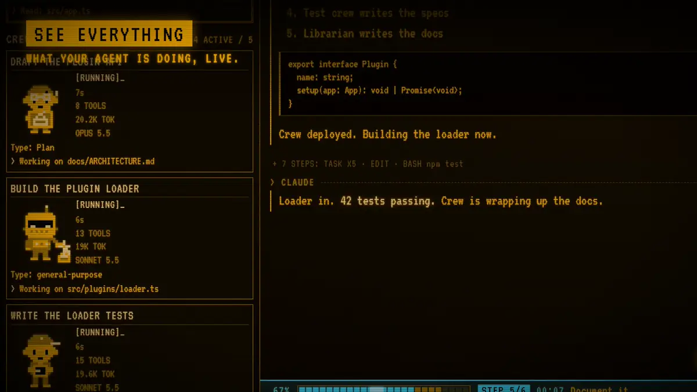
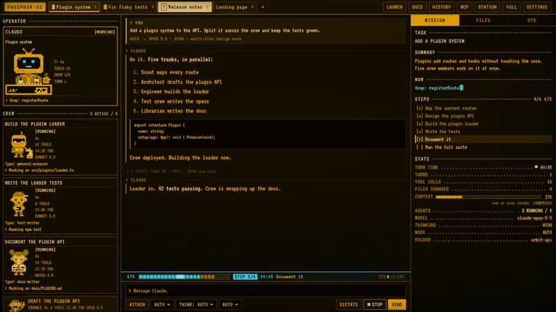
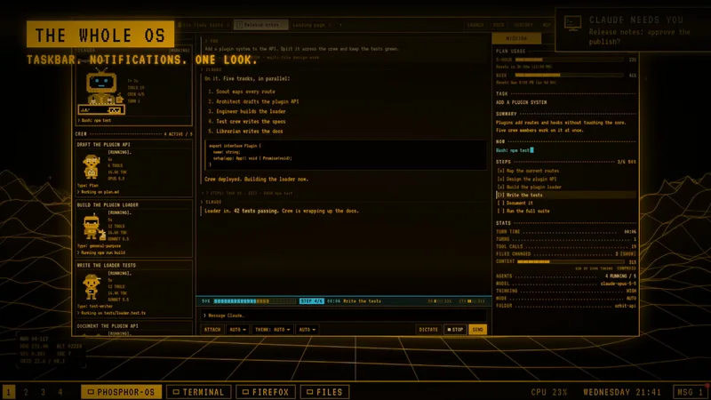
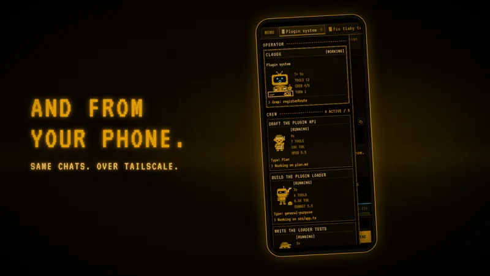

<div align="center">

<a href="https://phosphor.creativllc.net">
  <picture>
    <source media="(prefers-reduced-motion: reduce)" srcset="docs/media/banner-poster.png">
    
  </picture>
</a>

**The agent OS.** A retro CRT desktop and app to live in while you work with Claude Code agents.

[](LICENSE) [](https://code.claude.com) [](https://omarchy.org) [](#two-flavors) [](docs/LOCAL-MODEL.md)

[**Website**](https://phosphor.creativllc.net) &nbsp;·&nbsp; [**Trailer**](https://phosphor.creativllc.net/#trailer) &nbsp;·&nbsp; [**Install**](#two-flavors) &nbsp;·&nbsp; [**Docs**](docs/LINUX.md)

<table>
  <tr>
    <td width="33%"><a href="https://phosphor.creativllc.net/#see"></a></td>
    <td width="33%"><a href="https://phosphor.creativllc.net/#os"></a></td>
    <td width="33%"><a href="https://phosphor.creativllc.net/#phone"></a></td>
  </tr>
  <tr>
    <td align="center"><sub>See everything the agent does</sub></td>
    <td align="center"><sub>The whole OS, one look</sub></td>
    <td align="center"><sub>Same chats, from your phone</sub></td>
  </tr>
</table>

<sub>All footage is the app's demo mode with made-up data.</sub>

</div>

Amber (or green, or LCARS) phosphor on black. Powered by [Claude Code](https://code.claude.com), running Claude
(your own Anthropic login or API key) or a local model on your own GPU. Run **the app** on any computer, or make it
**the whole desktop** on [Omarchy](https://omarchy.org) Linux.

## Two flavors

| | The app | The desktop |
|---|---|---|
| Runs on | Windows 10 or 11, Apple Silicon Mac (untested), any x86-64 Linux | [Omarchy](https://omarchy.org) 4 (Arch + Hyprland) |
| What it changes on your computer | Nothing of the OS: a folder, a shortcut or menu entry, and a background server you can remove | The whole desktop, through the add-on pack in `os/`. Every change is listed in [docs/OMARCHY.md](docs/OMARCHY.md) and comes back off with `--undo` |
| The session HUD, chat tabs, AUTO, UNDO | yes | yes |
| DOCS, TODAY, the phone over Tailscale | yes | yes |
| Dictation inside the app | yes | yes |
| Dictation in any app (`Ctrl + Space`) | | yes |
| Theme, font and bar for the whole OS; taskbar; launcher on the Super key | | yes |
| Notifications that wait in the bar; clock popup with your events; night light | | yes |
| The screensaver for the whole computer | | yes |
| Markdown files open in DOCS on a double-click | | yes |
| Local models and the local image generator (optional) | Linux with an AMD card only, so far | yes (AMD card) |
| Install | [Linux](#install-the-app-on-linux), [Windows](#install-the-app-on-windows), [Mac](docs/MAC.md) | [Omarchy](#install-the-desktop-omarchy) |

## What you get

**See everything the agent does** (the session HUD)
- What the agent is doing right now, a plain-words summary, and the step list with a progress bar
- Context window gauge, model and thinking level, plan usage, files changed
- Sub-agents as a crew of cards, one per helper, with what each is doing
- Connectors: which ones the chat has, their state, and how often it used each

**Work in chat tabs**
- One Claude Code session per tab, each in its own folder; tabs come back after a restart
- Done and needs-you markers on every tab, and a phone buzz when a turn finishes or the agent waits for you
- AUTO: picks the model and thinking level for each message
- Undo from any of your messages (puts back the files the agent changed after it)
- Projects: a lead chat splits big work into thread chats (one per job), starts and steers them, and gets their reports; they sit together in the tab bar and in THREADS, and share one memory file
- Dictation: talk instead of type; the speech engine runs on your PC

**Around the chat**
- DOCS: a document editor over plain Markdown files
- TODAY: today's events (read-only Google Calendar link) and your Omarchy reminders, with a month view
- Local models (optional, bring your own): Qwen and Gemma through llama.cpp, from the same model picker
- Gemini chat (optional, Google AI Pro or Ultra): pick a Gemini model in a new chat and talk to Gemini in that chat's folder
- Phone access over Tailscale, private to your own devices

**The Omarchy add-on pack** (`os/`, the desktop flavor only)
- Amber theme (also green and LCARS) with the VT323 font
- Taskbar at the bottom of the bar, one button per window
- Launcher on the Super key
- Notifications that wait in a bar counter until you dismiss them
- Clock popup with a calendar and your events, and night light with warmth and a schedule
- The app's screensaver (flight over a grid, sleeping crew, big clock) as the whole computer's screensaver

**Just ask Claude to change anything.** The agent runs on your PC and can edit this desktop. The rule: every OS
change goes into the pack, so it can be undone (see [CONTRIBUTING.md](CONTRIBUTING.md)).

## Requirements

| You want | You need |
|---|---|
| The desktop | [Omarchy](https://omarchy.org) 4 on Arch (x86-64). Tested on 4.0.4 |
| The app | Node 24. Linux: x86-64 (`setup-linux.sh --app-only`; tested on Omarchy only). Windows 10 or 11 with PowerShell. Mac: Apple Silicon and Homebrew (untested) |
| Claude | Claude Code, logged in with your Anthropic account (`claude`, once, in a terminal). An API key may work through `ANTHROPIC_API_KEY` in `.env` (untested) |
| The phone | [Tailscale](https://tailscale.com) on the PC and the phone, same account |

Other agents (GPT, open models) are planned, not built. See [docs/AGENTS-PLAN.md](docs/AGENTS-PLAN.md).

## Install the desktop (Omarchy)

1. Log in to Claude Code once. Open a terminal and run `claude`, log in, quit it.
2. Get the code into a normal local folder (not a folder a sync client such as Nextcloud or Dropbox syncs to
   another PC; setup fills it with Linux files):

   ```
   git clone https://github.com/CreativLLC/phosphor-os.git ~/phosphor-os
   ```

3. See every step first, nothing is changed:

   ```
   bash ~/phosphor-os/scripts/setup-linux.sh --dry-run
   ```

4. Run it. It asks for the folder Claude works in (for example `~/workspace`), and asks before anything that needs
   sudo. It can be run again safely.

   ```
   bash ~/phosphor-os/scripts/setup-linux.sh
   ```

   It installs Node 24 (with mise), the packages, the page, the dictation engine (about 0.7 GB), Electron (about
   300 MB), the server as a user service, Tailscale serve if Tailscale is logged in, desktop mode and the look.
   Another look: add `--theme lcars` or `--theme retro-green`.

5. Log out and in (or reboot). Phosphor-OS starts maximized on workspace 1, under the bar.
6. Log in with the password. The server made one on its first start and saved it as `PHOSPHOR_PASSWORD` in
   `~/phosphor-os/.env`. Change it later in SETTINGS > SECURITY.

Only want the look, without the app setup? Run `bash ~/phosphor-os/os/omarchy/desktop.sh` (flags: `--theme NAME`,
`--dry-run`, `--undo`). Setup already runs it in its last step. Every change it makes is listed in
[docs/OMARCHY.md](docs/OMARCHY.md). Note: the pack turns off the idle lock (the password is asked only at boot; the screen
still turns off after 30 minutes idle); undo puts the old value back.

Full walk-through with keys: [docs/LINUX.md](docs/LINUX.md).

## Install the app on Linux

The same setup as the desktop, without the desktop part: it changes nothing of the OS but an app menu entry. Steps 1
to 3 of the desktop install, then:

```
bash ~/phosphor-os/scripts/setup-linux.sh --app-only
```

Later runs remember the choice. `--full` turns it into the desktop flavor on Omarchy. Start it from the app menu
(Phosphor-OS), or open http://localhost:7337 in a browser.

## Install the app on Mac

Apple Silicon only, and untested on a real Mac so far: [docs/MAC.md](docs/MAC.md). In short:

```
git clone https://github.com/CreativLLC/phosphor-os.git ~/phosphor-os
bash ~/phosphor-os/scripts/setup-mac.sh
```

## Install the app on Windows

```
git clone https://github.com/CreativLLC/phosphor-os.git
cd phosphor-os
npm ci
npm start
powershell -ExecutionPolicy Bypass -File scripts\setup-shell.ps1
```

`npm start` builds the page and serves http://localhost:7337. The last line adds the desktop app and its shortcut.
Dictation on Windows: `scripts\setup-voice.ps1`.

## First run

- Open the app (the desktop: it starts by itself at login; the app: the "Phosphor-OS" menu entry, shortcut or
  Spotlight; any OS: http://localhost:7337 in a browser) and log in.
- Open a chat tab and say what you want done. The HUD fills as the agent works.
- The desktop: `Super + Space` opens Omarchy's menu; type "doc" for DOCS. `Super + Alt + T` opens a plain terminal that works even
  when Phosphor-OS does not. All keys: [docs/LINUX.md](docs/LINUX.md).

## Phone

1. Install Tailscale on the PC (on Omarchy: `Super + Space` > Install > Service > Tailscale) and on the phone. Log in
   to the same account on both.
2. In the Tailscale admin console, DNS page: turn on MagicDNS and HTTPS Certificates.
3. On the PC: `tailscale serve --bg 7337` (setup does this for you when Tailscale is logged in).
4. On the phone, open `https://<pc>.<tailnet>.ts.net` (`tailscale serve status` shows the exact address) and log in.
5. Browser menu > Add to Home Screen.

**Never use `tailscale funnel`.** Funnel puts the app on the public internet, and this app can run commands on your
PC. The server listens on `127.0.0.1` only; `tailscale serve` is the only way in, and it reaches only devices on your
own tailnet. More: [SECURITY.md](SECURITY.md).

## Optional extras

- Calendar in TODAY and the clock popup: [docs/CALENDAR.md](docs/CALENDAR.md)
- Local models on your own GPU (AMD, about 27 GB of disk): [docs/LOCAL-MODEL.md](docs/LOCAL-MODEL.md). The easy way:
  Phosphor-OS is made for Claude Code, so let your agent do it. In a chat, ask: "Set up a local model for
  Phosphor-OS. Follow docs/LOCAL-MODEL.md." It checks your GPU, runs the setup with you and asks before anything
  that needs sudo. Then the local models show up in the model picker next to Claude.
- Local image generator on your own GPU (AMD, about 19 GB of disk): [docs/IMAGE-MODEL.md](docs/IMAGE-MODEL.md)
- Gemini pictures with a Google AI Pro or Ultra account (no API key, no GPU): [docs/IMAGE-MODEL.md](docs/IMAGE-MODEL.md#gemini-pictures-cloud-optional)
- Gemini chat with the same account: install Google's Antigravity CLI and sign in once as for Gemini pictures, restart the server, then in a new chat pick GEMINI 4 ARGON or GEMINI 3.8 FLASH. Gemini cannot stop to ask, so the mode picker decides what it may do: ASK FIRST reads and answers, PLAN ONLY writes a plan, AUTO-EDIT and AUTO may change files in the chat's folder; Gemini runs no commands (agy has none of Claude Code's safety hooks). Type `/quota` in a Gemini chat to see your Gemini limits. Details: PLAN.md, "Gemini chat".
- Settings (`PHOSPHOR_*`) are listed in `.env.example`

## Update

```
git -C ~/phosphor-os pull
bash ~/phosphor-os/scripts/setup-linux.sh
```

Setup rebuilds the page and changes only what differs. New server code loads at the next server restart:
`systemctl --user restart phosphor-os-server`. Do that when no chat is working: it cuts off a reply in progress.
After an update of the bar parts, `omarchy restart shell`. Windows: `git pull`, `npm ci`, run `npm start` again.
Mac: see [docs/MAC.md](docs/MAC.md#update).

## Uninstall

- Linux: `bash ~/phosphor-os/scripts/setup-linux.sh --undo`, then log out and in. It puts back the look, removes the
  Hyprland line it added, and asks before removing the service, Tailscale serve, Electron and the dictation engine.
  Only the look: `bash ~/phosphor-os/os/omarchy/desktop.sh --undo`.
- Windows: delete the "Phosphor-OS" desktop shortcut and `%LOCALAPPDATA%\PhosphorOS`.
- Mac: `bash ~/phosphor-os/scripts/setup-mac.sh --undo`.
- Add `--dry-run` to see first what would be undone.

## Troubleshooting

1. **Chat says you are not logged in.** Run `claude` in a terminal and log in. Setup warns when it finds no login.
2. **The screen is stuck or Phosphor-OS does not open.** `Super + Alt + T` gives a terminal. If the whole screen
   hangs, `Ctrl + Alt + F2` is a text login; run `bash ~/phosphor-os/scripts/setup-linux.sh --undo` there.
3. **`tailscale serve` is refused, or the phone cannot connect.** Run `sudo tailscale set --operator=$USER` once, turn
   on HTTPS Certificates (Phone, step 2), and use the address from `tailscale serve status`. Fingerprint login is per
   address: add it again if the PC's tailnet name changes.
4. **Setup or a restart killed a running chat.** The server is the parent of the agent processes, so restarting it
   stops them. Restart only when idle. Heavy work (installs, builds) can also run the PC out of memory and take the
   whole service down; wrap it in `systemd-run --user --scope -p MemoryMax=6G -- <command>`.
5. **Bar changes do not show.** Bar modules and shell plugins do not reload by themselves: `omarchy restart shell`.
   Also: do not keep the project inside a sync folder, and do not edit files under `/usr/share/omarchy/`.

## Contributing and security

[CONTRIBUTING.md](CONTRIBUTING.md), [SECURITY.md](SECURITY.md). Build record: [PLAN.md](PLAN.md).

## License

MIT, see [LICENSE](LICENSE).

## Credits

- [Omarchy](https://omarchy.org): the Arch and Hyprland desktop this is built on
- [Claude Code](https://code.claude.com) and the Claude Agent SDK, by Anthropic: the agent
- VT323 and Antonio (SIL Open Font License), Electron, Tailscale, llama.cpp, sherpa-onnx and the NVIDIA Parakeet model
  (dictation)
